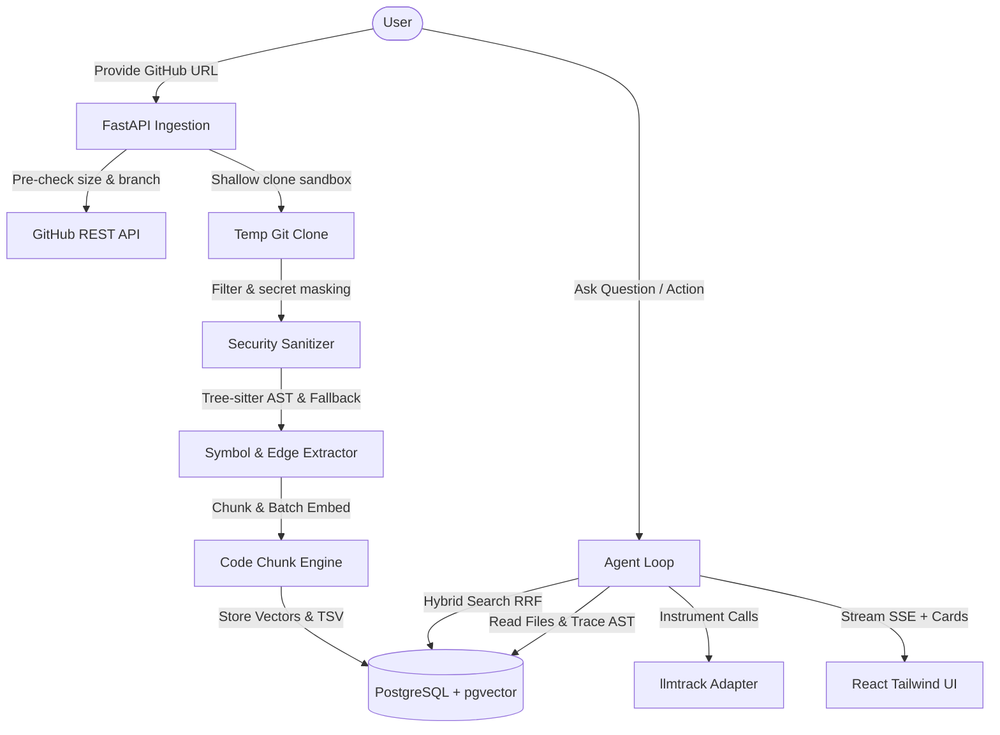

# SrcChat: Agentic Codebase Assistant for Public GitHub Repositories

SrcChat is a production-grade web application where users index one or more **public** GitHub repositories as pure text, extracting AST structure and embeddings, and then query the codebases across files and repositories using an agentic assistant.



---

## Safety & Security Architecture
- **Zero Code Execution**: Repositories are treated strictly as untrusted text datasets. No tests, builds, package managers, or scripts are ever run.
- **SSRF Hardening**: Only URLs matching `https://github.com/<owner>/<repo>` are accepted. Hostnames and paths are strictly validated against strict regex patterns.
- **Subprocess Safety**: All git operations are executed using argument lists (`subprocess.exec`), never shell interpolation (`shell=True`).
- **Secret Redaction**: Credentials, tokens, private keys, and `.env*` files are masked or skipped before chunking and embedding.
- **Prompt Injection Boundaries**: Untrusted code snippets are surrounded by explicit security boundary delimiters.

---

## Enforced Limits

| Metric | Enforced Limit | Behavior on Limit Exceeded |
| :--- | :--- | :--- |
| **Max Repo Size** | 100 MB | Rejected at API pre-check before cloning |
| **Max Files per Repo** | 3,000 files | Ingestion aborted early with clear error |
| **Max LOC per Repo** | 200,000 LOC | Ingestion aborted early |
| **Per-File Size Cap** | 300 KB | Skipped and counted |
| **Max Repos per Workspace** | 10 | Rejection on adding repo |
| **Concurrent Ingestion Jobs** | 2 | Async semaphore queue |

---

## Setup & Running

### Using Docker Compose
```bash
cp .env.example .env
docker compose up --build
```
- Frontend: `http://localhost:5173`
- Backend API Docs: `http://localhost:8000/docs`
- PostgreSQL pgvector: `localhost:5432`

### Running Backend Locally
```bash
cd backend
pip install -r requirements.txt
uvicorn app.main:app --reload --port 8000
```

### Running Frontend Locally
```bash
cd frontend
npm install
npm run dev
```

---

## Regression & Unit Tests
Run the test suite including the 25-query retrieval regression benchmark:
```bash
cd backend
pytest -v tests/
```
