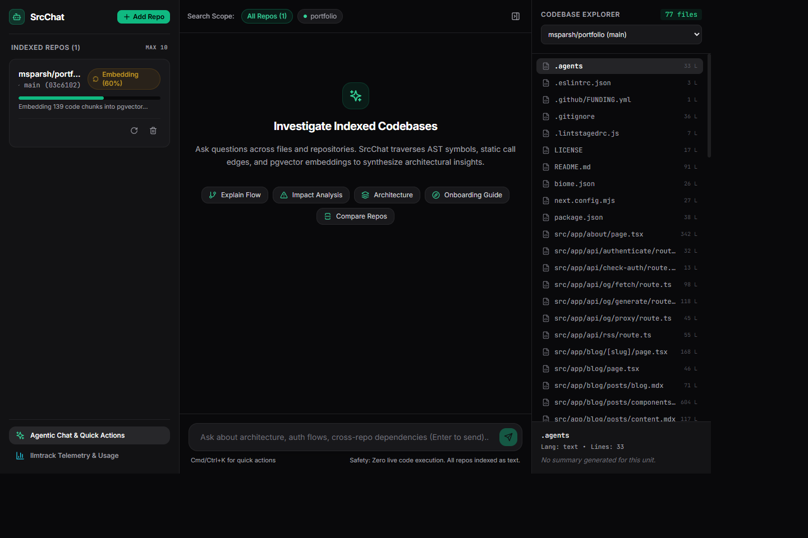
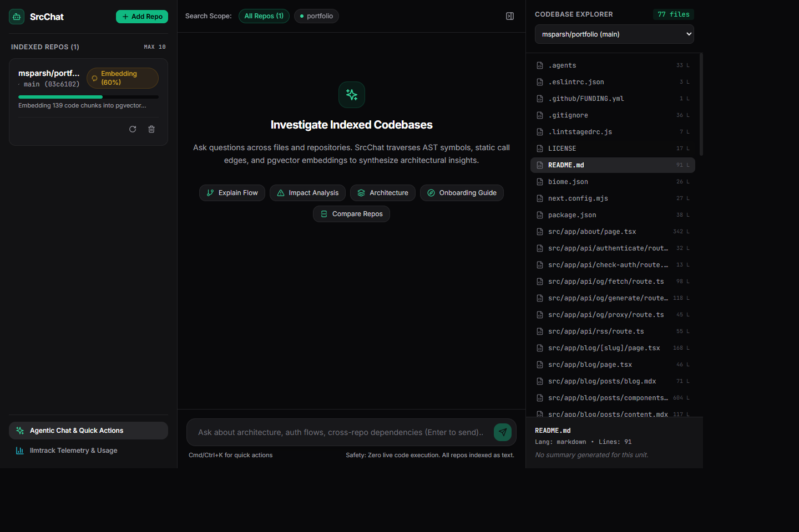
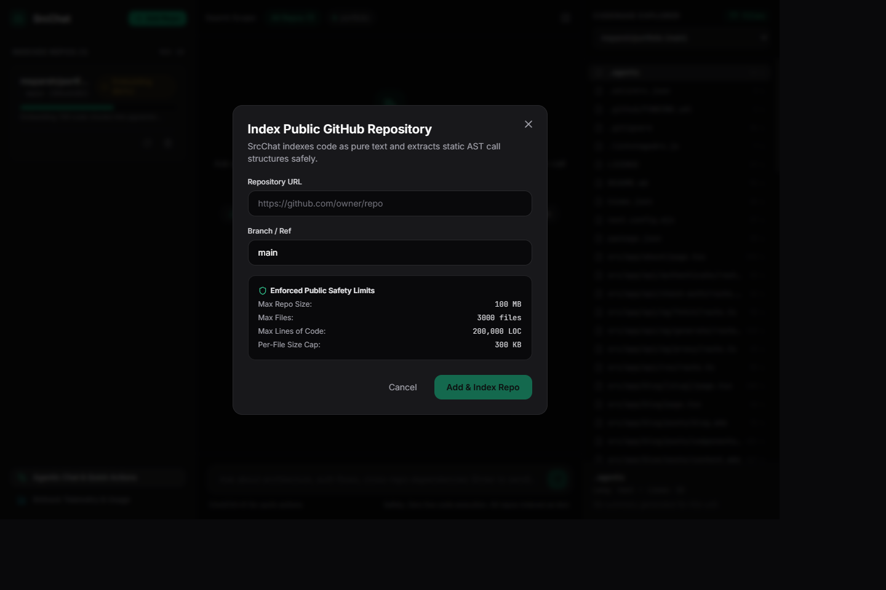

# SrcChat

A modern codebase assistant for exploring public GitHub repositories through semantic search, AST-aware indexing, and agent-driven analysis.

<p align="center">
  
  
  
  
</p>

SrcChat helps you add public repositories, index them safely, and ask questions about architecture, dependencies, flows, and change impact without executing the codebase itself.

## Highlights

- Search and analyze multiple repositories in one workspace
- Ask architecture, onboarding, flow, and impact questions
- Combine static structure analysis with vector retrieval and agent reasoning
- Keep repositories isolated as text-based, security-filtered data sources
- Explore results in a polished web UI with repo scope controls and structured outputs

## Screenshots

### Workspace



### Repository explorer



### Add a repository



## What it does

SrcChat is designed for code understanding at scale. You can index a repository, scope the search to specific repos, and ask questions like:

- Where does the request flow start and end?
- What parts of the system are most coupled to this model?
- Which files should a new engineer read first?
- What would be affected by changing this API contract?

The system reads repository content in a controlled way, extracts structural metadata, stores embeddings, and uses an agent to synthesize answers grounded in the indexed code.

## Tech stack

- Backend: Python, FastAPI, PostgreSQL + pgvector
- Frontend: React, TypeScript, Vite, Tailwind CSS
- Retrieval: semantic search, structured repo metadata, hybrid query flow
- Infra: Docker and Docker Compose

## Quick start

### 1) Configure environment

```bash
cp .env.example .env
```

Update the values as needed for your LLM and embedding provider. The default config is suitable for local smoke tests.

### 2) Run the app

```bash
docker compose up --build
```

Access the app here:

- Frontend: http://localhost:5173
- Backend docs: http://localhost:8000/docs
- PostgreSQL: localhost:5432

## Local development

### Backend

```bash
cd backend
pip install -r requirements.txt
uvicorn app.main:app --reload --port 8000
```

### Frontend

```bash
cd frontend
npm install
npm run dev
```

## Project structure

```text
.
├── .env.example
├── docker-compose.yml
├── LICENSE
├── README.md
├── backend/
│   ├── app/
│   │   ├── agent/
│   │   ├── api/
│   │   ├── core/
│   │   ├── db/
│   │   ├── ingest/
│   │   ├── llm/
│   │   ├── models/
│   │   ├── retrieval/
│   │   └── schemas/
│   ├── tests/
│   └── requirements.txt
├── docs/
│   ├── DECISIONS.md
│   └── screenshots/
│       ├── add-repository.png
│       ├── code-explorer.png
│       └── workspace-overview.png
├── frontend/
│   ├── src/
│   ├── package.json
│   ├── vite.config.ts
│   └── ...
└── .gitignore
```

## Safety model

SrcChat treats repository contents as untrusted data and keeps execution isolated.

- No live code execution or build/test runs against user repositories
- Strict validation of GitHub repository URLs
- Secret redaction before indexing and embedding
- Repository size, file count, and file-size guardrails
- Concurrency limits to avoid excessive ingestion spikes

## Limits

| Metric | Value |
| :--- | :--- |
| Max repo size | 100 MB |
| Max files per repo | 3,000 |
| Max LOC per repo | 200,000 |
| Max file size | 300 KB |
| Max repos per workspace | 10 |
| Concurrent indexing jobs | 2 |

## Testing

```bash
cd backend
pytest -q tests/
```

## License

MIT. See [LICENSE](LICENSE) for details.
